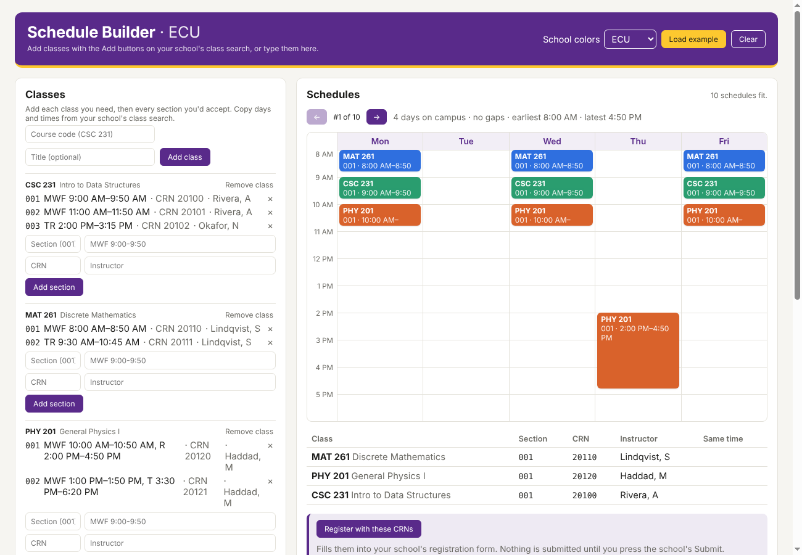
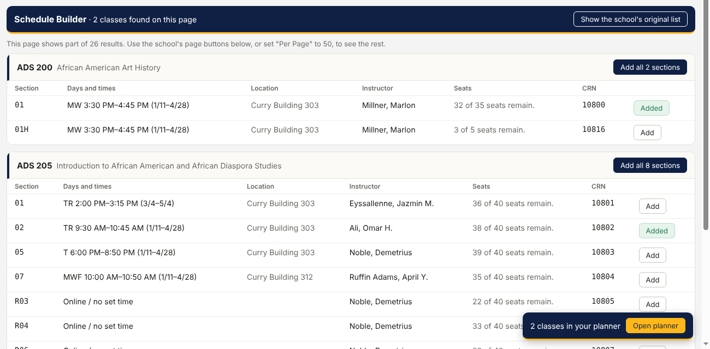

# Schedule Builder

A browser extension that puts a cleaner class search and a weekly schedule planner on top of a
school's older registration pages. Built for friends at UNCW, UNCG and ECU, modeled on how
schedule planning feels at NC State.

**Status:** UNCG is supported, built and tested against saved copies of UNCG's real Banner 9 pages
(class search, registration, and the registered-classes calendar). It has not yet been used live by a
UNCG student. UNCW and ECU also run Banner, but their pages haven't been checked yet.



## How it works

1. **On the school's class search**, the extension replaces the old results table with clear class
   cards (days, times, location, instructor, CRN) and adds **Add** buttons. One click on
   "Show the school's original list" brings the school's own table back.
2. **In the planner** (a full page inside the extension), the classes you added are combined into
   every schedule that fits, ranked by what you care about, on a weekly calendar.
3. **Already registered?** On the school's Registration page, **Show in my planner** brings the classes
   you're registered for into the planner, so you can see your current schedule in the weekly view.
4. **To register**, click **Register with these CRNs**. On the school's registration page the
   extension fills the CRN boxes for you. **It never presses Submit.** You check them and submit
   with the school's own button, so holds, prerequisites and errors are handled by the school.



**School colors.** The extension recognizes the school from the site's address (anything under
ecu.edu, uncw.edu or uncg.edu) and uses that school's colors on its class cards and in the planner:
ECU purple and gold, UNCW teal and gold, UNCG navy and gold. The planner also has a "School colors"
menu to pick one by hand. Colors only: no school logos or wordmarks.

The extension only reads pages you already have open while logged in. It never sees your password,
never contacts any server, and keeps your classes in your own browser.

Note: UNCW (Schedule Wizard), UNCG (Schedule Hero) and ECU (Schedule Planner) have official planners.
This is a personal project and is not affiliated with or endorsed by any school.

## UNCG details

- Reads UNCG's Browse Classes results (`erp-registration.uncg.edu/StudentRegistrationSsb/.../classSearch`):
  subject code, number, section, CRN, days, times, building and room, instructor, seats, and each
  section's own start and end dates.
- **Half-semester classes:** two classes at the same time in different halves of the term don't conflict.
- Online sections (no meeting time) never conflict with anything.
- A section whose time can't be read is left out and named on the page, never shown with a guessed time.
- Banner shows 10 results per page by default; the extension reads the page that's showing and says so.
- Registered classes come from the Registration page's summary and calendar. The calendar has no AM/PM,
  so times are inferred (1-7 = PM, 8-11 = AM) and checked against each block's position on the calendar.

Test pages in `frontend/src/extension/content/adapters/fixtures/` are trimmed from real UNCG pages with
the student's name, email and classes removed or replaced.

## Planner features

- **Every conflict-free schedule**, found with a backtracking search (details below).
- **Rules** that are never broken: busy times (work, practice), days off, no class before or after a time.
- **Ranking** by long gaps between classes, days on campus, early mornings and late evenings.
- **Explains empty results**: which class has no usable section and why, or which two classes always overlap.
- **Weekly calendar**, **Copy CRNs**, and **.ics export** for Google Calendar, Apple Calendar or Outlook.

## How the search works

1. **Filter.** Each section is checked against the rules. A class with no remaining sections stops
   the search with an explanation.
2. **Group.** Sections of the same class that meet at identical times become one option.
3. **Order.** Classes with the fewest options are placed first, so conflicts are found early.
4. **Search.** Depth-first search with backtracking abandons a branch as soon as two sections overlap.
5. **Rank.** Each schedule is scored and the best 50 are kept. The search stops after 100,000 schedules.

A randomized test compares the search against a brute-force version on 500 random inputs.

## Try it

```bash
cd frontend
npm install
npm test          # 84 tests
npm run build     # creates frontend/dist, the extension
npm run dev       # serves the made-up test pages at http://localhost:5173/demo/browse.html
```

Load the extension in Chrome or Edge:

1. Go to `chrome://extensions` and turn on **Developer mode** (top right).
2. Click **Load unpacked** and choose the `frontend/dist` folder.
3. With `npm run dev` running, open http://localhost:5173/demo/browse.html (add `?school=ecu`,
   `?school=uncw` or `?school=uncg` to try each school's colors), add some classes,
   click **Open planner**, then **Register with these CRNs**, then open the test page's
   "Register for Classes" link and click **Fill my CRNs**.

The planner also runs as a plain web page at http://localhost:5173 (click **Load example**).

## Adding a school

Everything school-specific lives in one file per school under
`frontend/src/extension/content/adapters/`, implementing `SchoolAdapter`:

- `matches(url)`: is this one of the school's registration pages?
- `readResults(document)`: the classes listed on a class-search results page.
- `crnForm(document)`: the CRN boxes on the registration page.

To write one, a student at that school saves their Browse Classes results page and their
Register for Classes page ("Enter CRNs" tab) with Ctrl+S, "Webpage, Complete". Saved pages can
contain a name or student ID: keep them private and never commit them. Then add the school's
web address to `content_scripts.matches` in `frontend/public/manifest.json`.

## Tech

TypeScript, React, Vite, Vitest, Chrome Extension Manifest V3.

## Not built yet

- UNCW and ECU (waiting on saved pages; both use Banner, so the UNCG reader may mostly carry over)
- Banner's linked sections (a lecture that requires a specific lab)
- Locking a section you must have
- Comparing two schedules side by side
